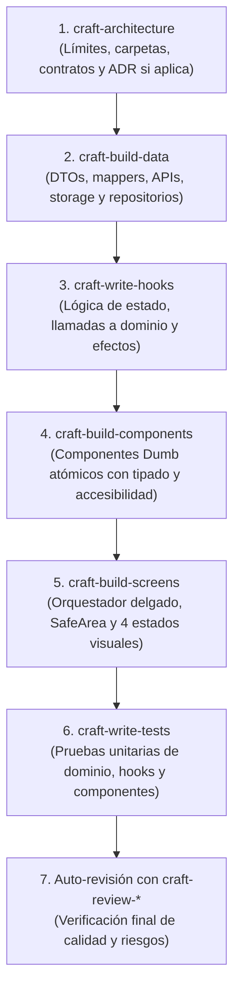

# Flujo de Trabajo y Ciclo de Vida de una Funcionalidad

Este documento define la secuencia estándar que el asistente debe seguir al coordinar la creación o modificación de una funcionalidad en React Native.

---

## 1. Pipeline de Ejecución Secuencial

Para evitar desorden y retrabajo, los skills especializados deben ejecutarse en este orden lógico:



### Reglas de despacho por fase:
1. **Fase de Diseño (`craft-architecture`)**: Si la funcionalidad introduce una nueva carpeta, módulo o contratos, definir primero la estructura (`domain/`, `data/`, `presentation/`). Si es un requerimiento simple, aplicar el Semáforo de Complejidad para no sobrearquitecturar.
2. **Fase de Datos (`craft-build-data`)**: Implementar DTOs, mappers y adaptadores de red o persistencia que cumplan el contrato del repositorio.
3. **Fase de Lógica (`craft-write-hooks`)**: Implementar la lógica reactiva, manejo de estados asíncronos, limpieza de efectos y cancelación antes de armar la UI.
4. **Fase de Componentes (`craft-build-components`)**: Crear o extraer los componentes visuales puros necesarios para la pantalla.
5. **Fase de Pantalla (`craft-build-screens`)**: Componer la vista orquestadora integrando el hook, los componentes locales en `<ScreenName>/` y los 4 estados canónicos.
6. **Fase de Pruebas (`craft-write-tests`)**: Escribir pruebas unitarias observables usando el stack del proyecto.
7. **Fase de Revisión (`craft-review-ui` / `craft-review-code`)**: Auto-revisar el diff contra regresiones antes de entregar.

---

## 2. Protocolo de Verificación Técnica Obligatoria

Antes de dar una tarea por finalizada, es obligatorio ejecutar y reportar las comprobaciones en este orden:

1. **Chequeo de Tipos (*Typecheck*)**:
   - Ejecutar `npx tsc --noEmit` o el script correspondiente del proyecto (`npm run typecheck`).
   - Corregir cualquier error tipado introducido.
2. **Linter**:
   - Ejecutar `npm run lint` si existe en el proyecto.
3. **Tests Automatizados**:
   - Ejecutar la suite de tests relevante (`npm test -- ...`).
4. **Declaración de Estado Honesta**:
   - Distinguir claramente en el reporte:
     - **Comprobado**: Comandos reales ejecutados en terminal y su resultado.
     - **Inferido**: Razonamiento estático del código sin ejecución.
     - **Pendiente**: Comportamientos que exigen prueba manual en dispositivo real o simulador (ej. interacción de gestos táctiles, cámara, biometría).

---

## 3. Plantilla de Registro en `.ai-kit/memory/progress.md`

Al completar la funcionalidad, registrar el avance al final de `.ai-kit/memory/progress.md` usando esta estructura:

```markdown
### [YYYY-MM-DD] - <Nombre de la funcionalidad o corrección>
- **Objetivo**: <Resumen en 1-2 líneas de lo implementado>.
- **Archivos creados/modificados**:
  - `src/features/<feature>/domain/use-<action>.ts`
  - `src/features/<feature>/presentation/hooks/use<Feature>.ts`
  - `src/features/<feature>/presentation/<Feature>Screen.tsx`
- **Skills coordinados**: `craft-architecture`, `craft-write-hooks`, `craft-build-screens`, `craft-write-tests`.
- **Comprobaciones reales**:
  - `npx tsc --noEmit`: 0 errores.
  - `npm test`: X pruebas aprobadas.
- **Siguiente paso / Pendiente**: <Próxima tarea o prueba manual recomendada en simulador>.
```

